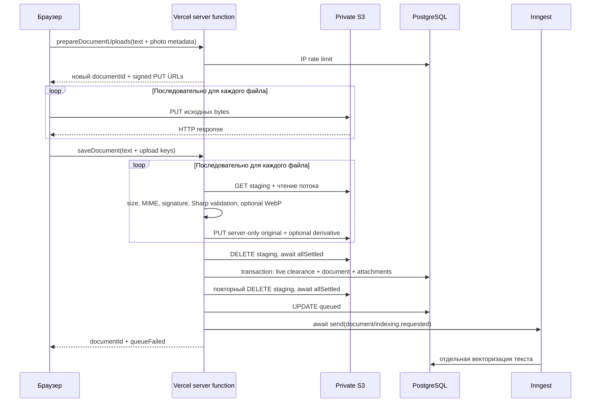

# ZIRVƏ V1 — диагностика фотографий и план асинхронной обработки

Дата: 24 октября 2026, Asia/Baku. Проверен `main` на GitHub и локально: `86c7f49587dc82c7fd9bee70915547bd283612f5`. Рабочее дерево до диагностики было чистым. В рамках этой работы runtime-код, схема БД и production не изменялись; commit, push, deployment, отправка Inngest events и production PUT/DELETE не выполнялись. Этот документ описывает предлагаемые изменения, а не внедрённую архитектуру.

## 1. Вывод и границы доказательств

**Точная причина прежнего сбоя не установлена.** Нет исходного файла, времени/HTTP-следа неудачного запроса и соответствующих Vercel/S3 logs. Формулировка пользователя — длительное ожидание и затем `fetch error`; точный класс/текст browser exception не сохранён. Нельзя объявлять причиной Sharp, CORS или Vercel timeout только по этому симптому.

Во время диагностики пользователь повторил загрузку с другим изображением из Google, около 45 КБ, и она прошла. Это подтверждает работоспособность хотя бы одного полного пользовательского сценария; постоянная поломка CORS/подписи менее вероятна для того же origin и окружения. Размер, пиксели, формат и целостность прежнего изображения неизвестны. Успех другого файла не исключает временный сетевой сбой или отказ валидации прежнего файла.

**Подтверждён механизм уязвимости:** текст сохраняется лишь после всей обработки фотографий; у сетевых операций нет заданного приложением общего deadline, а необязательный cleanup блокирует даже успешную обработку. Ошибка ответа не означает отсутствие записи в БД. Повторное нажатие создаёт новый идентификатор и может дублировать документ.

Доказательства:

- Статический анализ актуального кода, локального Vercel artifact и установленных SDK.
- 48 существующих unit/component tests в 8 файлах: PASS, 7.55 с.
- 2 временных UI diagnostics: PASS, 6.58 с. Они проверяют различие PUT/RPC errors и смену documentId при повторной отправке. Временный файл убран из `src`; копия сохранена в игнорируемой `.gate-backup`.
- 5 локальных fault-injection проверок с in-memory Storage: GET/stream/DELETE без завершения, уничтожение staging при ошибке пачки и невозможность повторно использовать потреблённый staging. Production не вызывался.
- Два read-only снимка настроенной PostgreSQL, без содержимого документов, пользователей, URL и ключей. Они показывают текущие настройки/агрегаты, но сами по себе не доказывают привязку production deployment к этому подключению.
- Историческая live-проверка private S3 от 22 октября — полезное свидетельство, но не проверка текущего CORS и не воспроизведение этого инцидента: [STORAGE_INTEGRATION.json](release/STORAGE_INTEGRATION.json).
- Финальная проверка ссылок/imports: 462 файла, 240 относительных Markdown links, 899 local imports, ошибок нет. Проверка форматирования новых отчётов пройдена. К завершению в workspace появились независимые изменения двух catalog routes (`_app.axtaris.tsx`, `_app.senedler.tsx`, удаление поясняющего текста фильтра); эта диагностика их не вносила и не изменяла.

## 2. Реальный путь документа с фотографиями

Исходники: [форма](../src/routes/_app.senedler_.yeni.tsx), [server functions](../src/lib/documents.functions.ts), [commitImageUploads](../src/server/storage/image-uploads.ts), [S3Storage](../src/server/storage/s3.ts), [Sharp](../src/server/storage/optimize-image.ts).



1. `prepareDocumentUploads`, строки 186–221: проверка clearance, rate limit 30 подготовок / 10 минут на IP, генерация UUID документа и ключей `documents/{id}/uploads/{user}/{uuid}.{ext}`. Создания документа/draft в PostgreSQL здесь **нет**; есть запись rate limit. Presigning при статических credentials не передаёт bytes в S3.
2. Browser PUT, форма 118–132: файлы отправляются **последовательно**. Все URLs выданы заранее. Нет application timeout, пользовательской отмены, прогресса, возобновления или refresh URL. На S3 идут bytes; через Vercel RPC — текст и метаданные.
3. `saveDocument`, строки 223–318: снова clearance, затем `commitImageUploads` **до** SQL transaction. По каждой фотографии: GET, ограниченное чтение, signature/size/MIME, Sharp, новый приватный original и optional WebP. Оригинал — точные исходные bytes, не результат перекодирования.
4. Helper в `finally` удаляет staging **и при успехе, и при ошибке** и ожидает все DELETE. При ошибке пачки предварительно удаляет созданные committed copies. После успешной SQL transaction `saveDocument` повторно удаляет те же staging keys.
5. Только затем `queueDocumentIndexing` обновляет queued и ожидает `inngest.send`. Обработка embeddings не выполняется в save, но сетевой вызов отправки события входит в задержку ответа.
6. Без фотографий loops/DELETE пустые. Остаются auth/rate-limit, короткая SQL transaction и отправка события — этим объясняется существенно меньший путь, но не устанавливается виновник исторического сбоя.

`attachmentId` из prepare форма отбрасывает. При SQL insert вложения получают новые UUID. Этот идентификатор сейчас не обеспечивает attachment idempotency.

## 3. Где появляется именно fetch error

| Этап                                     | Реальное поведение                                                                                       | Что можно заключить                                                                                                         |
| ---------------------------------------- | -------------------------------------------------------------------------------------------------------- | --------------------------------------------------------------------------------------------------------------------------- |
| RPC prepare                              | Network rejection до handler, auth/DB/middleware error или потеря ответа попадают во внешний catch формы | Raw exception message может отображаться пользователю                                                                       |
| Browser PUT                              | Reject fetch и любой HTTP non-2xx заменяются на `az.documents.form.photoUploadFailed`                    | Буквальный raw `fetch error` на этом пути скрывается; если пользователь пересказывает сообщение, PUT остаётся кандидатом    |
| RPC save                                 | Потеря соединения/ответа, platform error, сбой чтения/десериализации ответа идут во внешний catch        | Raw message может отображаться; локальный UI test воспроизвёл `fetch error` именно здесь                                    |
| GET/PUT S3, Sharp внутри commit          | Обычный reject перехватывается и превращается в `uploadMetadataMismatch`                                 | Сообщение ошибочно смешивает invalid image, network error и processor busy. Незавершающийся Promise этот catch не запускает |
| PostgreSQL / post-commit cleanup         | DB rejection идёт наружу; сетевое ожидание может оборвать платформа                                      | К моменту ошибки ответа запись может уже существовать                                                                       |
| `inngest.send`                           | Rejection превращается в `queueFailed`; зависший вызов продолжает удерживать save                        | Отказ доставки обычно должен дать «сохранено, очередь ожидает», но bounded ожидания нет                                     |
| invalidate/navigate после успешного save | Входят в тот же try/catch формы                                                                          | Ошибка дальнейшей навигации тоже может выглядеть как ошибка сохранения; форма к этому моменту уже сброшена                  |

В application source нет собственной строки `fetch error`. TanStack client RPC использует fetch; network rejection пробрасывается, неуспешный не-JSON ответ может стать `Error(response.text())`, есть отдельные ошибки framing/parse. **HTTP 504 сам по себе не равен network rejection fetch:** fetch обычно возвращает Response. Чтобы различить эти случаи, нужен URL path, status, duration и request ID неудачного RPC.

## 4. Что может ждать слишком долго

| Операция                                     | Ограничение сейчас                                                                             | Проблема                                                                                                           |
| -------------------------------------------- | ---------------------------------------------------------------------------------------------- | ------------------------------------------------------------------------------------------------------------------ |
| Browser PUT                                  | Нет заданного приложением timeout                                                              | Слабая сеть/обрыв, очередь файлов и retries браузера могут длиться долго                                           |
| Server S3 GET/PUT/DELETE                     | Нет явных connection/socket/whole-operation timeouts в S3Storage и нет переданного abortSignal | Await может пережить допустимый бюджет handler                                                                     |
| Чтение S3 stream                             | Ограничено число bytes, не время получения следующего chunk                                    | `reader.read()` может не завершаться; fault injection это подтвердил                                               |
| `Promise.allSettled` cleanup                 | Только подавляет rejection                                                                     | Не ограничивает длительность; один pending DELETE блокирует всё. Воспроизведено даже после успешного committed PUT |
| Sharp import/metadata/ожидание native worker | Нет общего wall-clock deadline                                                                 | Возможные точки ожидания, но нет доказательства, что это случилось в инциденте                                     |
| SQL connect                                  | `connect_timeout=10` секунд                                                                    | Это не deadline ожидания pool slot или всей transaction                                                            |
| SQL queries/locks                            | Приложение не задаёт statement/lock timeout; см. фактический read-only снимок ниже             | Долгие запросы/row locks и очередь pool могут задержать handler                                                    |
| Inngest send                                 | В приложении нет deadline; установленный SDK делает до 5 attempts                              | Отправка/response body может ждать; SDK retry не означает ограничение времени одного запроса                       |

У установленного AWS SDK Node runtime используется `NodeHttpHandler`. Defaults могут зависеть от AWS defaults mode/environment: некоторые режимы задают connection timeout, но в приложении это не закреплено. Нельзя подменять отсутствующий общий deadline предположением «в SDK всё timeout-ится». Для fix важно передавать abortSignal и на SDK send, и на чтение body: получение headers не завершает передачу bytes.

Чтение attachment тоже заслуживает отдельного исправления: [attachment route](../src/routes/api.attachments.$kind.$parentId.$attachmentId.ts) буферизует original/derivative до 10 MiB в SQL transaction с `FOR SHARE`, затем возвращает ArrayBuffer. Медленный S3 GET способен удерживать connection/locks и задерживать административное изменение пользователя. Это путь **просмотра**, не доказанная причина save error. Кроме того, buffered original больше Vercel response limit может успешно сохраниться, но не открыться через этот endpoint.

## 5. Действующие timeout и лимиты

### Код и локальный artifact

- [vite.config.ts](../vite.config.ts): `/api/inngest` — 300 с, `/api/analytics/search` — 300 с. Это правила конкретных маршрутов.
- `.vercel/output/functions/__server.func/.vc-config.json`: Node.js 24, streaming supported, **maxDuration отсутствует**. Catch-all в `.vercel/output/config.json` направляет обычные server functions в `__server`. Следовательно, 300 с для analytics/Inngest нельзя автоматически приписывать saveDocument.
- `.vercel/output/functions/api/inngest.func/.vc-config.json`: Node.js 24, maxDuration 300 с. Artifact уже существовал локально; заново не собирался и не выкладывался.
- Фактические plan, Fluid setting, deployment SHA, dashboard defaults, memory/region и duration `__server` на production в этой работе **не подтверждены**. Runtime logs конкретного сбоя недоступны. Нет оснований утверждать, что у save лимит именно 10, 60, 120 или 300 секунд.

По актуальной [официальной документации Vercel](https://vercel.com/docs/functions/limitations), при Fluid Compute default — 300 с на всех планах; Hobby maximum — 300 с, Pro/Enterprise — 800 с, extended maximum — 1800 с в beta при выполнении условий. Превышение maxDuration даёт 504 `FUNCTION_INVOCATION_TIMEOUT`. Request/response payload limit — 4.5 MB; память Hobby до 2 GB, Pro/Enterprise до 4 GB. [Настройка duration](https://vercel.com/docs/functions/configuring-functions/duration) должна относиться к реальной функции.

Большие фото идут напрямую в S3, поэтому 4.5 MB **не является автоматическим запретом** загрузить фото 10 MiB. Ограничение относится к RPC body/response и к buffered attachment delivery. Rich JSON ограничен приложением 4,000,000 bytes и 500,000 символами текста; wire serialization RPC имеет overhead, поэтому размер валидного rich document тоже следует проверять в transport E2E. Считать это причиной данного photo-specific сбоя нельзя.

### Приложение

| Параметр                | Значение                                                                                                            |
| ----------------------- | ------------------------------------------------------------------------------------------------------------------- |
| Изображений в документе | До 10                                                                                                               |
| Размер одного           | 1…10 MiB; до 100 MiB исходных bytes на пачку                                                                        |
| MIME                    | JPEG, PNG, WebP                                                                                                     |
| Signed PUT              | Default 300 с; helper разрешает максимум 900 с                                                                      |
| Signed GET helper       | Default/maximum 3600 с; UI использует authenticated attachment route                                                |
| Sharp pixels            | До 16,000,000; сторона до 16,384; channels до 4; multipage/animation отвергаются                                    |
| Sharp validation decode | `.timeout({seconds:5})`                                                                                             |
| Sharp WebP conversion   | Ещё `.timeout({seconds:5})`; ошибка conversion допускает validated original                                         |
| Sharp concurrency       | cache off, libvips concurrency 1; максимум 2 активных optimizeImage на Node instance, следующая получает busy error |
| DB pool                 | Default max 3, configurable 1…50; idle_timeout 20 с, connect_timeout 10 с                                           |
| Text embedding batch    | 32 фрагмента, abort timeout 90 с на batch                                                                           |
| Text indexing           | Inngest retries 1, concurrency 3; stale lease 6 минут; recovery cron каждые 15 минут, максимум 5 recovery attempts  |
| Orphan cleanup          | Cron 02:00 UTC, unreferenced объекты возрастом не менее 24 ч                                                        |

Sharp timeout не является общим deadline всего save: по [документации Sharp](https://sharp.pixelplumbing.com/api-output/#timeout), ожидание свободного libuv thread не входит в его таймер. `metadata()` и import не окружены отдельным deadline. При этом обработка уже ограничена pixels/bytes и native processing timeout. Простые локальные solid-color JPEG 2000×1500 и 4000×4000 прошли optimizeImage за 74 и 123 мс соответственно. Это только sanity check native codec, **не production benchmark** и не доказательство поведения неизвестного файла.

Телефонное фото, сжатое до <10 MiB, всё равно может превышать 16 MP. Например, 4032×3024 проходит pixel limit, 8064×6048 — нет. Корректное отклонение такого файла не нужно «исправлять» отключением проверок; UI должен объяснять причину.

### PostgreSQL: read-only наблюдение

В 10:53:50 и 11:00:02 Asia/Baku подключение через настроенный `DATABASE_URL` показало:

- `statement_timeout=2min`, `lock_timeout=0`, `idle_in_transaction_session_timeout=0` до диагностических SET LOCAL.
- Диагностическая transaction была `READ ONLY`; только для её собственных запросов выставлялись statement timeout 10 с и lock timeout 2 с. Глобальные настройки не менялись.
- В обоих снимках нет lock waiters и idle transactions. Это не исключает прошлую блокировку, невидимые статистики или pool queue.
- В первом снимке за последние 24 ч: 16 `ready` документов, 0 с фотографиями. После сообщения пользователя об успешной загрузке: 16 `ready`, 1 с фотографиями. Агрегаты меняются; по ним нельзя установить судьбу прежней попытки или идентифицировать конкретный файл.

## 6. CORS, signed URLs, S3, Sharp и приватность

**Подтверждено кодом:**

- Browser получает право PUT только для user/parent-scoped staging key. Подпись привязана к Content-Type и Content-Length. Браузер сам устанавливает Content-Length для File; вручную выставлять этот запрещённый browser header не нужно.
- Server проверяет ownership key, actual byte length, declared/stored MIME, magic signature и bounded decoding через Sharp. Для PNG/JPEG сохраняются исходные bytes и optional display WebP только при экономии >5%; WebP не перекодируется. Derivative поворачивается по EXIF и ограничивается 1600×1600 без enlargement.
- Committed original имеет новый server-only UUID key; reuse staging PUT не меняет его. Это логическая immutable-copy модель приложения, а не доказанный bucket Object Lock/WORM.
- Authenticated read проверяет текущие active/clearance и отдаёт private/no-store response. В S3Storage нет `public-read` ACL. Private bucket и IAM/provider permissions нужно сохранять; CORS не является ACL.
- Presigned PUT — bearer capability. Проверка пользователя в приложении не отзывает уже выданную S3-подпись автоматически. По [AWS semantics](https://docs.aws.amazon.com/AmazonS3/latest/userguide/using-presigned-url.html), URL может использоваться повторно до expiry, а PUT по существующему key заменяет объект. Именно поэтому нельзя использовать staging key как immutable original.

**Исторически проверено 22 октября:** private Supabase bucket, signed read, unsigned/public denial, отказ при mismatch signed size/type, ownership/signature и immutable copies. В `verify-stage-1.ts` предусмотрен OPTIONS probe production origin, но наличие этого кода само по себе не доказывает текущий PASS CORS.

**Сейчас не проверено live:** bucket policy/ACL, CORS для актуального origin, server credentials/region, signed PUT/GET и native Sharp на deployed runtime. Локально отсутствует полный набор S3/hosting management credentials; production storage probe с записью запрещён рамками задачи. Успешная загрузка 45 КБ — более свежее пользовательское свидетельство работоспособности, но не полный security/config audit.

Отдельный воспроизводимый риск URLs: они выдаются одновременно на 300 секунд, а document PUT выполняется последовательно. Если первые файлы заняли >300 секунд, следующий файл начинает PUT уже с истёкшим URL. Для десяти файлов по 10 MiB на канале около 2.5 Мбит/с даже без overhead девятый файл способен исчерпать этот бюджет до начала десятого. Это объясняет один возможный класс долгого ожидания, **но количество прежних файлов неизвестно**. Для одиночного файла нельзя автоматически использовать эту гипотезу. Поведение S3-compatible provider на границе expiry следует проверить отдельно; AWS не обещает успешный новый retry после expiry.

## 7. Подтверждённые дефекты и гипотезы

### Подтверждённые дефекты реализации

1. **Photos блокируют сохранение текста и запуск его indexing.** SQL начинается после обработки всей пачки. Ошибка одной фотографии предотвращает запись текста, хотя сама ошибка не связана с текстом.
2. **Неограниченное ожидание сетевого шага.** Нет общего deadline и timeout чтения S3 stream; `allSettled` не ограничивает cleanup. Pending GET/read/DELETE воспроизведены локально.
3. **Staging cleanup выполняется дважды.** Helper ждёт его перед SQL; save повторяет после SQL. Второй DELETE не добавляет проверку фотографии и способен испортить ответ уже записанного документа.
4. **Retry формы неидемпотентен.** Новый prepare — новый documentId. UI test показал разные ID для двух submit после RPC error. Если первый SQL commit уже состоялся, второй submit может создать второй документ и новые attachments.
5. **Replay save с тем же payload тоже не является успешным retry.** У документа PK предотвращает второй insert с тем же ID, но нет «вернуть существующий идентичный результат». После commit helper staging уже удалён; повтор получает missing object ещё до insert. После ошибки второй фотографии staging всей пачки удалён, включая успешно переданную первую. Это воспроизведено.
6. **Диагностика уничтожает причину.** Любой commit rejection, включая network/codec/busy, маркируется metadata mismatch; browser PUT non-2xx и network failure не различаются; server stage timings/request correlation отсутствуют.
7. **UI не имеет отдельного состояния фотографии.** Есть один saving и text indexing status. Пользователь не знает, где задержка и что уже сохранено.
8. **Время жизни заранее выданных URL не связано с очередью upload.** Refresh expired URL отсутствует.

### Подтверждённые опасные ветки; наступление в этом инциденте не доказано

- Потеря browser response после SQL commit оставляет документ и attachments в БД, хотя форма показывает ошибку. Поздние cleanup, queue, response serialization и navigation расширяют это окно.
- Ошибка SQL transaction не всегда означает rollback: возможна потеря подтверждения COMMIT. `saveDocument` в catch безусловно удаляет новые committed keys. Если БД фактически закоммитила, это может удалить originals уже существующих attachments. Нельзя компенсировать неопределённый исход удалением без повторного подтверждения ссылок. Эта distributed failure ветка обнаружена по коду, в production не воспроизводилась.
- Если процесс прекращён между committed PUT и SQL insert, остаются orphaned copies; ежедневный sweep нужен даже при best-effort cleanup. Возраст 24 ч + суточный cron означает обычно удаление через 24–48 ч, а не гарантированно через 24 ч.
- Уже выданная staging подпись остаётся пригодной после logout/deactivation до expiry. Дальнейшие RPC/new URLs должны отклоняться; transaction save проверяет live active/clearance повторно. Имеющийся committed original не изменяется повторным staging PUT.
- `queueDocumentIndexing` делает live-filtered update после commit. Отзыв доступа в этот момент либо конкурентное изменение status может привести к ошибке ответа при уже сохранённом документе. Recovery остаётся отдельным системным механизмом.
- Attachment original размером >4.5 MB может столкнуться с Vercel response limit на buffered GET. Это отдельный дефект доставки, не доказательство сбоя загрузки.

### Гипотезы причины прежнего сбоя

| Гипотеза                                         | Статус и необходимое доказательство                                                                 |
| ------------------------------------------------ | --------------------------------------------------------------------------------------------------- |
| Медленный/оборванный browser PUT                 | Нужны transfer timing и PUT response; 45 КБ не характеризует неизвестный исходник                   |
| Зависший S3 GET/PUT/DELETE в save                | Реализация допускает, fault injection подтверждает; нужны stage timings/S3 error metadata инцидента |
| Vercel invocation timeout / process OOM          | Нужны production function identity, duration, invocation logs, 504/error code или process exit      |
| Invalid/truncated/слишком большое по pixels фото | Нужны bytes/MIME/dimensions/validation code исходника                                               |
| Sharp долго обрабатывал изображение              | Пока нет такого доказательства; нужны decode/encode/queue duration и сведения о файле               |
| Постоянный CORS/signature/config defect          | Новый успешный сценарий ослабляет; нужны OPTIONS и PUT с тем же origin/заголовками                  |
| Истечение signed URL                             | Возможно при долгой очереди или позднем retry; нужны issuedAt/startAt и provider error code         |
| DB lock/pool wait либо Inngest send              | Код допускает; current snapshot без блокировок не устанавливает прошлое                             |

## 8. Конкретное минимальное исправление до миграции архитектуры

**Предлагаемый узкий patch исправляет доказанное зависание на staging DELETE; он не объявляется доказанным лечением неизвестного исторического запроса. В этой работе patch не применялся.**

1. Добавить helper option `cleanupStaging?: boolean` с default `true`, чтобы сохранить текущее поведение briefs.
2. В `saveDocument` вызвать `commitImageUploads(..., {cleanupStaging:false})`.
3. В helper выполнять finally-delete только если option не `false`.
4. Удалить повторный staging DELETE после SQL transaction в `saveDocument`.
5. В document path staging удаляет уже существующий daily orphan cleanup. Он private, а оригинал — отдельная server-only copy. Проверить регистрацию cleanup и допустимость хранения staging 24–48 ч до выпуска patch. Rollback cleanup неудачных committed copies пока остаётся, но также требует bounded I/O.

Эскиз предлагаемого diff:

```diff
 // image-uploads.ts
   uploads: T[],
+  options: { cleanupStaging?: boolean } = {},
 // в finally
-  await Promise.allSettled(uploads.filter(/* ownership */).map(/* delete */));
+  if (options.cleanupStaging !== false)
+    await Promise.allSettled(uploads.filter(/* ownership */).map(/* delete */));

 // documents.functions.ts: saveDocument
   data.uploads,
+  { cleanupStaging: false },
 // после SQL transaction
-  await Promise.allSettled(data.uploads.map(({ key }) => storage.delete(key)));
```

Это устраняет **оба** ожидания document staging cleanup без public bucket, отключения проверок или переноса Sharp в новый worker. Недостаток: увеличение времени хранения staging и объёма orphan sweep; это нужно принять явно при реализации. Если требования требуют немедленного удаления, вместо пропуска нужен ограниченный по времени DELETE с реальным SDK abort и последующим sweep; запуск незакреплённого Promise после return не является надёжным cleanup.

Следующий небольшой набор исправлений нужен независимо от перехода на async:

- В `S3Storage` закрепить connection/socket timeout и явный retry budget; передавать общий operation AbortSignal в `client.send` и удерживать его до окончания stream. Раздельно ограничить время без bytes и полное время операции. В актуальном Smithy `requestTimeout` может только логировать предупреждение без `throwOnRequestTimeout`; одного этого параметра недостаточно.
- Для save установить явный общий бюджет ниже **проверенного** deployed maxDuration. Для короткого cleanup, например, 2–3 с общего бюджета; для connect — около 3 с; конкретные transfer/batch бюджеты выбрать после замеров размера/канала, не копировать analytics 240/255 с. Browser cancellation и UI timeout должны обозначать «результат неизвестен», а не «документ точно не сохранён».
- Ошибки разделить на upload transport, expired signature, invalid MIME/signature/dimensions, processor busy, storage timeout и save outcome unknown. Давать пользователю локализованный текст и request ID; сырые signed URL/body/token/provider errors не логировать.
- До автоматического retry сохранить один creation key/documentId и разрешать server replay только при том же actor и идентичном creation payload. После неопределённого ответа сначала восстановить результат по этому ключу; несовпадение payload → conflict. Простого отключения кнопки недостаточно.
- При неопределённом COMMIT не удалять потенциально referenced originals. Перепроверить transaction outcome новым соединением; если БД недоступна, оставить объекты для reference-aware sweep.
- URL выдавать/обновлять для ближайшего файла после live ACL check; retry после expiry получает новую подпись для той же логической upload session.

Для окончательного RCA нужны sanitized stage logs: `requestId`, `creationKey`, opaque document/attachment IDs, stage, elapsedMs, declared/actual bytes, MIME, width/height, S3 HTTP status/error code/request ID, SDK attempts, timeout scope, `dbCommitted`, send outcome, Vercel invocation ID/SHA/region. Не писать текст документа, raw filename, bytes, cookies, credentials и query подписанных URL. Браузер отдельно фиксирует prepare/PUT/save и факт начала навигации.

## 9. Целевая асинхронная архитектура

### 9.1 Сохранение текста и надёжная доставка text event

`createDocument` получает текст, метаданные, stable client creation key и manifest ожидаемых фото. В **одной короткой SQL transaction**:

1. Проверяет active user, live clearance, право создания и ограничения manifest.
2. Создаёт/находит `document_creations` по UNIQUE `(actor_id, creation_key)`. Хранит canonical payload hash, documentId и результат; одинаковый retry возвращает прежний результат, другой payload с тем же key — conflict. Cross-user replay запрещён.
3. Записывает document/bodyRich/body и `status=queued`. Сохраняет независимый `content_revision`; uploads не должны двигать text indexing lease/heartbeat.
4. Создаёт ожидаемые attachment slots и upload sessions, но **не** объявляет их сохранёнными фотографиями.
5. Записывает outbox `document/indexing.requested` для этой content revision.
6. Commit и быстрый ответ: `textSaved=true`, documentId, text status, ожидаемые photo slots.

После commit dispatch начинается сразу, без ожидания фото. Fast dispatch можно запускать через поддержанный hosting lifetime primitive; надёжность обеспечивает SQL outbox + отдельный bounded dispatcher/reconciler. Если process умер между commit и send, dispatcher отправит событие; если send сработал, а ACK потерян, duplicate безопасен. Быстрый ответ не должен зависеть от доступности Inngest event API. Цель — sub-second DB save в обычных условиях; SLO подтвердить замерами, не обещать фиксированную latency при недоступной БД.

Существующую text векторизацию и её lease/recovery переиспользовать. Сейчас `processDocumentJob` не использует named `step.run`: это один worker invocation с 90 с per embedding batch и host limit 300 с. Новая photo очередь не должна добавляться внутрь этого handler. Для очень длинного текста общий indexing budget и разбиение на durable batches — отдельная совместимая задача.

### 9.2 Модель состояния

| Сущность            | Минимальные поля/инварианты                                                                                                                                                      |
| ------------------- | -------------------------------------------------------------------------------------------------------------------------------------------------------------------------------- |
| document_creations  | actorId, creationKey, canonicalPayloadHash, documentId UNIQUE, committed result                                                                                                  |
| documents           | Существующий текст; отдельные contentRevision/indexedRevision и indexing status/progress/error                                                                                   |
| attachment slots    | stable attachmentId, documentId, clientFileId, ord; UNIQUE `(documentId, clientFileId)`; пока нет verified original — фото не считается сохранённым                              |
| upload sessions     | attachmentId, generation, uploaderId, expectedMime/bytes, exact stagingKey, signedUntil, expiresAt, upload/validation state, receivedAt, attempts, lease token/expiry, errorCode |
| attachment original | immutable server-only key, verified MIME/size/dimensions/hash; publication state и generation; UNIQUE slot для актуального original                                              |
| optimization        | original generation, optimizer version, state, derivative key/bytes/dimensions, attempts/error; ошибка optimization не удаляет verified original                                 |
| outbox              | stable eventId, entityId/revision/generation, kind, nextAttemptAt, lease, delivery state; UNIQUE бизнес-операции                                                                 |

Отдельная таблица upload sessions сохраняет текущую семантику `attachments`: строки без проверенного original не обязаны становиться видимыми вложениями. При наличии нескольких попыток одному slot принадлежит одна активная generation. SHA не используется для глобального cross-user dedup: это могло бы раскрыть совпадение приватных материалов и не является идентичностью вложения.

Статусы пользователя:

- Текст: сохранён → в очереди → индексируется → готов / ошибка индексации.
- Передача фото: ожидает выбора/передачи → передаётся → передача подтверждена сервером / истекла / отменена.
- Проверка: в очереди → проверяется → отклонено / оригинал проверен и сохранён.
- Оптимизация: ожидает → выполняется → готово / не требуется / ошибка с доступным проверенным оригиналом.

Browser PUT 200 может отображаться как «передано, ожидает проверки». «Фото сохранено» допустимо только после проверки bytes и успешного persistence original + metadata. Все expected slots показываются, но только verified/published считаются saved count/cover. Text status ready не скрывает photo failures.

### 9.3 Независимый upload и подтверждение

1. Browser после text commit получает короткоживущий signed PUT **на конкретный slot/generation**, после live management/clearance check. До 2 параллельных PUT для начала; memory/network budget подтвердить нагрузкой.
2. Сохраняются ограничения до 10 файлов, 10 MiB на файл, JPEG/PNG/WebP и signed Content-Length/Type. Добавляются per-user/parent quotas и ограничения числа выдач/попыток; URL refresh не создаёт новый документ или attachment slot.
3. `completeUpload(sessionId, generation)` после browser PUT выполняет короткую live ACL проверку, HEAD exact key/size/type и атомарно записывает received state + processing outbox. HEAD не заменяет signature/decode и не публикует фото.
4. Если browser закрылся после фактического PUT, но до complete, durable reconciler находит ожидающие sessions и проверяет exact staging key. Успешная находка ставит ту же processing задачу. Так завершение передачи не зависит только от последнего browser callback.
5. Если S3 object отсутствует, session остаётся awaiting upload до срока; после него expired. При неопределённом PUT проверяется наличие/целостность, затем решается retry. Возобновление непереданных bytes после закрытия браузера не гарантируется: пользователь повторно выбирает файл; сохранённый текст остаётся в БД.

S3/provider webhook может ускорить пункт 4 **только** после проверки поддержки конкретным S3-compatible backend и аутентификации уведомления. Нельзя спроектировать обязательную зависимость от AWS notifications, не проверив Supabase. DB reconciler остаётся fallback; клиентский callback сам по себе не доказывает корректность файла.

### 9.4 Фоновая проверка original и WebP

На один slot/generation — отдельная Inngest processing function. Она загружает всю авторитетную информацию из БД, а не доверяет event key/MIME/owner.

1. Коротким SQL compare-and-set получает lease на текущую generation. Повторное событие для ready/cancelled/устаревшей generation завершает работу без новых side effects. Нужны lease token и fencing на каждом final update.
2. До дорогого I/O проверяет существование документа/session, generation, срок и актуальные права инициатора. После каждой долгой границы проверяет cancellation/access перед публикацией.
3. Читает staging ограниченным потоком с deadline/byte cap. Повторно проверяет actual length, stored/declared MIME, signature, dimensions, pixels, channels, animation и bounded decoder. HEAD не считается полной валидацией.
4. Вычисляет hash **считанных bytes**; пишет эти же bytes в новый server-only immutable original. Не делать слепой CopyObject mutable staging после проверки: между проверкой и copy staging можно перезаписать действующим signed PUT.
5. Короткая finalization transaction с повторной live ACL проверкой и fencing публикует original + metadata для slot/generation. При проигранной гонке объект остаётся непубличным orphan и подлежит cleanup. При неизвестном DB ACK — reconciliation, а не слепой DELETE.
6. Отдельный durable step оптимизирует уже проверенный immutable original, с текущими Sharp bounds, EXIF rotate, resize 1600, quality 82, effort 3. WebP/no meaningful saving → skipped; временный encoder failure → retry или явный optimization_failed, original доступен. Validation failure original не может быть обойдён fallback.
7. Derivative записывается под отдельный versioned server-only key; metadata обновляется только при той же original generation/lease. Staging и проигравшие candidates удаляются отдельным cleanup, вне ответа createDocument.

В `step.run` возвращать только IDs/state/key metadata; **не** сериализовать 10 MiB bytes в Inngest state. Между этапами заново читать immutable storage. По [документации Inngest](https://www.inngest.com/docs/durable-execution/primitives/step-run), сохранённый step result ограничен 4 MiB и hosting timeout может быть короче платформенного. Лимит photo worker должен быть явным и меньше подтверждённого host limit; 300 с на существующем `/api/inngest` не разрешает бесконечный native process. Для жёсткой изоляции native hangs/OOM потребуется отдельный worker process/service, если измерения покажут такую необходимость.

### 9.5 Idempotency, retries и доставка

- Document retry использует постоянный creation key и проверку canonical payload; успех после потери ответа восстанавливается lookup-ом, а не новым prepare.
- Attachment retry использует тот же slot/clientFileId. Новая передача/замена bytes повышает generation; старое событие и старый worker не могут публиковать результат поверх новой generation.
- Stable event ID, например `attachment:{slot}:generation:{n}:process`, подавляет лишнюю доставку в Inngest, но не заменяет UNIQUE/CAS в PostgreSQL. [Inngest dedup](https://www.inngest.com/docs/durable-execution/guides-and-advanced/idempotency) действует 24 ч, и side effects могут завершиться до фиксации step ACK. Дубликат через несколько суток тоже должен быть безопасен.
- В пределах generation original candidate keys — UUID на попытку/lease, только server writers. Один победитель публикуется CAS; остальные — orphan. Если backend поддерживает conditional create, его можно добавить после live compatibility проверки. Не перезаписывать published key другой версией bytes.
- Network/429/5xx/busy → bounded backoff с jitter и ограниченным сроком. Invalid signature/size/dimensions → terminal rejected. Expired URL → обновление подписи после ACL, а не повтор старой ссылки. Временные storage failures не объявляются metadata mismatch.
- Outbox имеет retry/lease/dead-letter visibility; recovery cron переиздаёт задачи со stale lease. Периодic dispatcher покрывает event-send ACK ambiguity. Успех индексации текста не зависит от retry фотографий; обработка фото не запускает повторные embeddings.

## 10. Закрытие браузера, отмена и отзыв доступа

| Событие                                                  | Требуемое поведение                                                                                                                                                    |
| -------------------------------------------------------- | ---------------------------------------------------------------------------------------------------------------------------------------------------------------------- |
| Браузер закрыт до text commit                            | Нет обещания сохранения; stable creation key позволяет определить неизвестный исход при возвращении                                                                    |
| Браузер закрыт после text commit, до PUT                 | Текст и indexing outbox сохранены. Фото pending/expired; позже пользователь выбирает файл повторно                                                                     |
| PUT прерван                                              | Не считать фото saved. Проверить exact object; только полные корректные bytes могут пройти background verification                                                     |
| PUT завершён, complete/его ответ потерян                 | Reconciler обнаруживает object/session и запускает ту же проверку; repeated complete идемпотентен                                                                      |
| Browser request abort после commit                       | Не удалять документ; abort транспорта не откатывает уже завершённую SQL transaction                                                                                    |
| Пользователь отменил фото                                | Отдельный authenticated cancel меняет session generation/state, fence останавливает публикацию; очищается только это фото, текст остаётся                              |
| Повторная Inngest delivery / timeout после PUT original  | DB lease/UNIQUE/generation/CAS определяют единственный опубликованный результат; лишний object очищается                                                               |
| Signed URL истёк                                         | Refresh той же session после live ACL check; pending/verified state восстанавливается из БД                                                                            |
| Пользователь деактивирован/clearance отозван до finalize | New URLs, complete, retry, cancel/read требуют актуальных прав; незавершённая пользовательская загрузка не публикуется worker-ом, остаётся blocked/cancelled + cleanup |
| Доступ отозван между worker check и publish              | Final transaction повторно проверяет active/clearance/management и синхронизируется с ACL update; stale worker не публикует                                            |
| Документ удалён в процессе                               | Worker finalization не находит актуальную parent/generation, не воссоздаёт документ; orphaned storage очищается                                                        |
| Отзыв доступа после публикации                           | Существующий original не удаляется только из-за потери прав uploader; доступ сохраняется для остальных уполномоченных пользователей, revoked user не получает bytes    |

Уже выданный direct S3 PUT нельзя мгновенно отозвать только обновлением app user в PostgreSQL. Он может доставить bytes в private staging до expiry, но не должен иметь права committed PUT/GET и не даёт права публикации. Если обязательна немедленная остановка самой передачи после revocation, нужен upload proxy или иная revocable credential схема; standalone signed PUT такой гарантии не обеспечивает. Короткий TTL + exact staging key + fail-closed finalize/worker + cleanup ограничивают это окно без раскрытия данных.

Существующая text indexing — системная задача над уже сохранённым документом. Deactivation uploader не должна автоматически уничтожать текст или ломать доступ других пользователей. Политику остановки незавершённой photo job следует применять к её инициатору; права на уже опубликованный документ/attachment проверяются по текущему читателю.

## 11. Cleanup и приватность после перехода

- Сохраняется private bucket; browser подписывает только exact staging PUT. Никаких public-read ACL, публичных derivatives и прямых постоянных S3 URLs в UI/events.
- Attachment read проверяет текущий session/active/clearance и публикацию original; stale generation/failed validation недоступны. Решение для >4.5 MB original download требует отдельного transport review: streaming через подходящий endpoint/provider либо краткий signed GET с явно принятым revocation window. Нельзя молча заменить live ACL proxy часовой bearer ссылкой.
- Текущий sweeper знает только attachments/briefAttachments. **До включения async** он обязан учитывать upload sessions, pending immutable candidates, published originals/derivatives, retry retention и active leases; иначе удалит ещё нужный файл после 24 ч ожидания/retry.
- Для старых unreferenced keys сохраняется правило возраста ≥24 ч. Новые DB-referenced sessions/candidates защищаются до expiresAt/retry deadline/lease expiry; затем становятся eligible. Retention должна превышать разрешённое окно retry, а не просто signed URL TTL. Устаревшие завершённые sessions и outbox тоже очищаются по согласованной политике.
- Delete сверяет отсутствие ссылок и действующих lease непосредственно перед действием. Finalization запрещена для отменённой/expired generation. Не держать SQL row locks во время долгого S3 I/O; применять fencing/tombstone/claim протокол для гонок delete и publish.
- После hard kill, ambiguous storage PUT/SQL commit и проигранного CAS возможны физические orphan copies; это допустимо при приватности и надёжном sweep. Логическое вложение остаётся единственным.

## 12. Порядок внедрения и критерии приёмки

1. **Закрыть наблюдаемость и минимальные дефекты:** stage/error codes, bounded S3/stream/cleanup; убрать двойной staging DELETE, восстановление результата сохранения вместо нового UUID при неизвестном исходе. Прогнать fault injection без production.
2. **Additive migration:** creation idempotency, attachment sessions/generation/lease, outbox, отдельный photo state. Старые attachments считать уже verified, existing keys/metadata/оригиналы не переписывать. Обновить reference-aware cleanup до выпуска новых producers.
3. **Text-first API + outbox:** после commit немедленная независимая отправка text indexing. Сохранить старые события, существующие documents/briefs и runtime ACL. Text payload hash/version не менять при photo progress.
4. **Photo worker + reconciliation:** exact-key pending scan, Inngest durable steps, native bounds, original/derivative publication CAS, retry/error policy, cancellation/revocation.
5. **UI:** две независимые панели статуса, per-photo progress/errors/retry/reselect, polling и после text ready, восстановление session после reload. Текущий polling `/senedler/$id` останавливается на text ready — его необходимо изменить для pending photos.
6. **Preview fault-injection + bounded load:** затем отдельно согласованный rollout через feature flag. History не переписывать; commit/push/deployment в эту задачу не входят.

Обязательные сценарии приёмки:

- 0/1/10 фотографий; 45 КБ, несколько MiB и 10 MiB; допустимые/слишком большие dimensions, animated/truncated/mismatched images. Text save latency не растёт с bytes/count или доступностью S3.
- Ошибка первой/последней фотографии не удаляет сохранённый текст, не блокирует его indexing и не удаляет другие verified photos.
- Disconnect/close/abort до и после каждой durable границы, включая PUT success до complete, COMMIT до ACK, event accepted до ACK и derivative PUT до DB update.
- Двойной submit, две вкладки, повтор same key/same payload, same key/different payload, повтор attachment complete, duplicate event в пределах и после 24 ч; один документ и одно логическое вложение на slot.
- URL expiry до старта PUT и после разрыва соединения; refresh не меняет document identity и не обходит ACL/размеры.
- Отзыв active/clearance/role во время upload/validation/optimization/finalization/read; все new/publication/read checks fail closed, чужие документы не затрагиваются.
- Конкурентные cancel/delete/retry/cleanup, старый lease и новая generation; никакого удаления published original и публикации stale bytes.
- Pending job старше 24 ч; cleanup учитывает retry retention/leases. Повтор staging PUT после успеха не изменяет original/derivative.
- Недоступность Inngest: текст сохраняется, outbox переживает restart, после восстановления обработка стартует один раз логически. Недоступность S3: text indexing продолжает работать.
- Sharp decode/encode timeout/busy/OOM simulation, S3 stalled stream/slow DELETE, DB lock/pool pressure; bounded завершение и корректный retry status.
- Приватность unsigned/public GET/PUT, direct UUID access, signature Content-Length/Type, реальные CORS headers текущего origin, оригинал >4.5 MB на deployed transport.

**Решение:** переход на async обоснован требованиями сохранности текста, независимости indexing, retry и переживания browser lifecycle. Он не требует считать Sharp виновником. Ближайшее точечное изменение должно устранять подтверждённое ожидание cleanup и давать измеримый stage/error trace; окончательный incident root cause остаётся открытым до получения файла либо соответствующего HTTP/runtime evidence.
